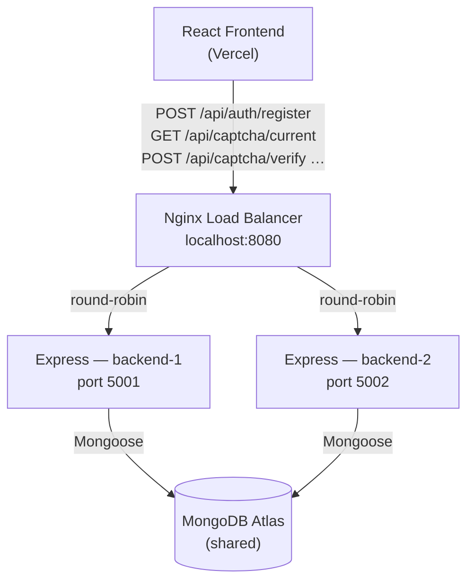

# Load Balancer — VELoop Rewards

Nginx reverse proxy that distributes API requests across two Express backend instances using round-robin load balancing.



---

## Architecture

| Layer | Technology | Role |
|---|---|---|
| Frontend | React + Vite → Vercel | User interface |
| Load balancer | Nginx 1.27-alpine | Proxy + round-robin |
| Backend × 2 | Node.js / Express | Business logic, CAPTCHA, rewards, auth |
| Database | MongoDB Atlas | Single shared store |

**All three containers** run on a private Docker bridge network (`veloop-net`). Only the Nginx container exposes a port to the host (`8080`). The two backend instances are internal and unreachable from outside Docker.

---

## Prerequisites

- [Docker Desktop](https://www.docker.com/products/docker-desktop/) installed and running
- Node.js 18+ (only needed to run `lb-test.js`)
- MongoDB Atlas cluster already accessible from your machine

---

## Setup

### 1. Create the backend secrets file

```bash
cp backend/backend.env.example backend/backend.env
```

Edit `backend/backend.env` and fill in real values:

| Variable | Required value |
|---|---|
| `MONGO_URI` | Your Atlas connection string |
| `JWT_SECRET` | 64+ char random string |
| `FRONTEND_URL` | `http://localhost:8080` (for local LB testing) |
| All others | See `.env.example` for defaults |

> `backend/backend.env` is gitignored. Never commit it.

Both backend instances use **the same file** — same database, same JWT secret, same config.

---

## Running Locally

```bash
# From the repo root (d:\vellop)
docker compose up --build
```

Wait until all three containers are healthy:
```
veloop-backend-1  | [Server] VELoop API running on port 5001 (production)
veloop-backend-2  | [Server] VELoop API running on port 5002 (production)
veloop-nginx-lb   | nginx: configuration file ... test is successful
```

Test the stack:
```bash
# Nginx health (Nginx itself responds — no backend needed)
curl http://localhost:8080/nginx-health

# Backend health through proxy
curl http://localhost:8080/api/health

# Full test suite
node load-balancer/lb-test.js
```

---

## Verifying Round-Robin Distribution

Each request goes to the next backend in sequence. You can see it in the Nginx access log:

```bash
docker logs veloop-nginx-lb | grep upstream
```

You will see `upstream="172.x.x.x:5001"` and `upstream="172.x.x.x:5002"` alternating.

Alternatively, watch both backend logs simultaneously:
```bash
docker logs -f veloop-backend-1 &
docker logs -f veloop-backend-2 &
# Then send several requests — each backend will log alternate ones
```

---

## Testing Instance Failure (Failover)

```bash
# Stop one instance
docker stop veloop-backend-1

# Traffic should continue to backend-2 (Nginx max_fails=3 fail_timeout=10s)
curl http://localhost:8080/api/health     # still succeeds

# Restore
docker start veloop-backend-1
```

---

## Environment Variables

### Backend instances (`backend/backend.env`)

| Variable | Description |
|---|---|
| `MONGO_URI` | MongoDB Atlas connection string |
| `JWT_SECRET` | ≥64-char secret — **must be identical on both instances** |
| `JWT_EXPIRES_IN` | Token lifetime (default `1d`) |
| `PORT` | Set by docker-compose per instance (`5001` / `5002`) |
| `NODE_ENV` | `production` |
| `FRONTEND_URL` | Allowed CORS origin — `http://localhost:8080` locally |
| `CAPTCHA_EXPIRY_SECONDS` | Challenge TTL in seconds (default `120`) |
| `RATE_LIMIT_WINDOW_MS` | Rate limit window in ms |
| `RATE_LIMIT_MAX_REQUESTS` | Global limit per IP per window |
| `CAPTCHA_*_LIMIT_MAX` | Per-endpoint limits |

### Nginx load balancer (set in `docker-compose.yml`)

| Variable | Description |
|---|---|
| `BACKEND_1_HOST` | Container name of instance 1 (`backend-1`) |
| `BACKEND_1_PORT` | Port of instance 1 (`5001`) |
| `BACKEND_2_HOST` | Container name of instance 2 (`backend-2`) |
| `BACKEND_2_PORT` | Port of instance 2 (`5002`) |

---

## Shared-State Analysis

The application was inspected for state that would cause problems across multiple instances:

| Concern | Finding | Safe? |
|---|---|---|
| JWT authentication | Stateless — verified from `JWT_SECRET` on every request | ✅ Safe across instances — same secret required |
| CAPTCHA challenges | Stored in MongoDB with atomic `findOneAndUpdate` | ✅ Cross-instance safe |
| Duplicate reward prevention | `GemTransaction.referenceId` unique index in MongoDB | ✅ DB-level guard, instance-agnostic |
| Duplicate claim prevention | Atomic `{ claimStatus: 'PENDING' }` filter in MongoDB | ✅ Cross-instance safe |
| Wallet balance updates | `$inc` atomic operation — no read-modify-write | ✅ Cross-instance safe |
| Rate limiting | `express-rate-limit` uses **in-memory store** per process | ⚠️ See note below |
| Authentication sessions | No sessions — stateless JWT only | ✅ Safe |
| Temporary files | None | ✅ Safe |

### ⚠️ Rate Limiting Note

`express-rate-limit` with its default in-memory store counts hits **per process**. With two instances:
- A user can make twice the configured limit of requests (once per instance) before being blocked.
- Each instance maintains its own counter independently.

**For a local demo this is acceptable.** For a strict production deployment, replace the in-memory store with a shared store such as [`rate-limit-redis`](https://github.com/express-rate-limit/rate-limit-redis). This is **not** implemented here because it would require adding a Redis dependency to the application, which is outside the minimal-change requirement.

---

## Stopping the Services

```bash
docker compose down          # stop and remove containers
docker compose down -v       # also remove volumes (if any)
```

---

## Production on Render — Current Limitation

> **This Docker Compose setup is a local demonstration only.**

The current production backend is a **single Render Web Service**. Render's free tier does not provide:
- A way to expose two separate backend services behind a single custom Nginx container
- Direct network access between services for private upstream routing

### Options to achieve production load balancing

| Option | What it requires |
|---|---|
| **Render paid plan + Private Network** | Two Render Web Services on a paid plan with Private Network enabled. Nginx runs as a third Render Web Service connecting to both backends via private hostnames. |
| **Fly.io** | Deploy Nginx and two backend apps on Fly.io. Fly supports private networking between apps out of the box on free tier. |
| **Single VPS (e.g. DigitalOcean, Hetzner)** | Run all three containers via `docker compose up` on one VPS. Nginx is the only public-facing service. |
| **AWS / GCP / Azure** | EC2/GCE instances or ECS/Cloud Run for backends; Application Load Balancer or Nginx on a dedicated instance. |

For internship/demo purposes, the local Docker Compose setup faithfully demonstrates the load-balancing architecture.

---

## Files

```
load-balancer/
  nginx.conf.template   — Nginx config with envsubst placeholders
  Dockerfile            — Nginx image that resolves placeholders at startup
  lb-test.js            — End-to-end test script (Node 18+, native fetch)
  .env.example          — Template for Nginx env vars
  README.md             — This file

backend/
  Dockerfile            — Backend image used by both compose instances
  backend.env.example   — Template for backend secrets (never commit backend.env)

docker-compose.yml      — Orchestrates nginx-lb + backend-1 + backend-2
```
